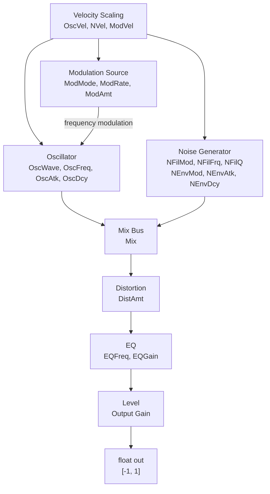

# Synth Signal Path

The host PO-32 synth reconstruction renders a single drum hit from 21 float
parameters (`po32_patch_params_t`). Callers supply values in `[0.0, 1.0]`.
The behavior below describes this implementation; it does not establish
sample-for-sample equivalence with Microtonic or a physical PO-32.

## Block Diagram

## Oscillator

The oscillator generates the tonal component of the drum sound.

- **OscWave** selects one of three waveforms: sine below `1/3`, triangle from
  `1/3` to below `2/3`, and saw from `2/3` upward.
- **OscFreq** maps exponentially from 20 Hz to 20 kHz before pitch modulation.
- **OscAtk / OscDcy** control an amplitude envelope with exponential
  attack and decay curves. The renderer and text importer share the
  [attack-time mapping](PATCH_PARAMETERS.md#attack-time-oscatk-nenvatk), which
  spans 0–10000 ms. Amplitude decay spans 10–10000 ms.

## Modulation

The modulation section controls pitch modulation of the oscillator,
which is essential for creating impact transients in kicks, toms,
and other percussive sounds.

- **ModMode** selects the modulation source:
  - below `1/3`: exponential decay (pitch sweep)
  - `1/3` to below `2/3`: undamped sine modulation starting at maximum excursion
  - `2/3` upward: filtered noise modulation
- **ModRate** uses a separate nonlinear mapping for each source: Decay maps
  positive rate `x` to `(1.03-x)/(3*x)` seconds, Sine to
  `2000*x*pow(10, 3.5*(x-1))` Hz, and Noise to
  `20000*x*pow(10, 4*(x-1))` Hz. At `0.5`, these are approximately 353.33 ms,
  17.783 Hz, and 100 Hz respectively. An imported decay-mode `inf ms` becomes
  zero. Zero rate holds Decay/Sine at maximum excursion and Noise at its seeded
  trigger value. Reset repeats the host's deterministic random sequence.
- **ModAmt** uses a squared bipolar curve: `b = 2*x-1`, then
  `b*abs(b)*limit` semitones. The limit is 96 in Decay mode and 48 in Sine/Noise
  modes; `0.5` gives zero depth. Sine depth remains constant over time.

## Noise Generator

An independent noise path with its own filter and envelope:

- **NFilMod** selects low-pass below `1/3`, band-pass from `1/3` to below `2/3`,
  or high-pass from `2/3` upward.
- **NFilFrq** sets the filter cutoff/center frequency, capped at `0.45 * sample_rate`.
- **NFilQ** sets the filter resonance.
- **NEnvMod** selects exponential attack/decay at values up to `1/3`, linear
  ramps above `1/3` through `2/3`, or a damped cosine above `2/3`.
- **NEnvAtk / NEnvDcy** control the noise amplitude envelope. Linear mode uses
  two-thirds of the mapped times. Cosine mode holds unity until the mapped
  attack time, then decays; its modulation period also depends on NEnvDcy and
  sample rate. A zero derived period falls back to exponential decay.

## Mix

**Mix** blends between the oscillator and noise generator.
`0.0` = pure oscillator, `1.0` = pure noise.

## Distortion

**DistAmt** controls a gain-compensated nonlinear waveshaper. Values at or below
`0.01` bypass it. The final output is separately clamped to `[-1, 1]`.

## EQ

A single-band parametric equalizer:

- **EQFreq** sets the center frequency, capped at `0.45 * sample_rate`.
- **EQGain** boosts or cuts at that frequency (bipolar around 0.5).
  The EQ filter is bypassed when the mapped gain is within 0.5 dB of zero.
  A positive boost of `B` dB also reduces whole-output gain by `B/2` dB;
  this attenuation still applies when a small positive boost bypasses the
  filter. Cuts add no gain compensation.

## Output

**Level** sets the base output gain, followed by any EQ boost attenuation.

## Velocity

Three velocity sensitivity parameters (**OscVel**, **NVel**, **ModVel**)
scale how MIDI velocity affects the oscillator level, noise level, and
modulation depth respectively. At `0.0`, velocity has no effect. Normalized
values `0.5` and `1.0` correspond to text-import sensitivities of 100% and 200%.
The response uses the nonlinear [velocity gain curve](PATCH_PARAMETERS.md#velocity-gain).

## Implementation

The synth uses lookup tables and polynomial/bit-level approximations for runtime
math, without libm trig. The floating-point sine, exp2, and log2 tables contain
4096 entries: 16 KiB with four-byte floats. They are compile-time constants;
actual linked size depends on compiler optimization and table retention.
Attack and pitch-modulation maps are shared with the text importer in
[`po32_param_maps.h`](../src/po32_param_maps.h). The sine modulation oscillator
is renormalized every 256 absolute samples to limit amplitude drift without
making its behavior depend on render chunk boundaries.

Output is mono `float` in `[-1, 1]` at the caller-specified sample rate.
