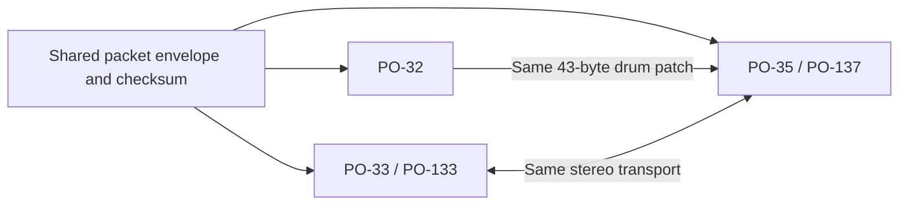

# How the Pocket Operator formats relate

[Format overview](../PO_FORMATS.md) · [PO-32](PO32.md) · [PO-33/133](PO33.md) · [PO-35/137](PO35.md)

The formats share a packet system and several musical concepts, but they are
not one layout with different sound bodies. **PO-35 is the bridge:** it shares
PO-33's stereo transport and PO-32's drum-patch representation. Its settings
and drum-pattern organization are also closer to PO-32 than to PO-33.



## Evidence in this pass

The 2026-11-06 audit rechecked 24 retained references: thirteen official PO-32
download entries, three official PO-33 packs, one supplied PO-133 reference,
and seven PO-35/137 references or controls. One PO-32 download duplicates another
frame. The resulting 23 distinct frames comprise 12 PO-32, four sampler, and
seven speech-family frames. Model attribution comes from provenance, not an
authenticated device identifier in the bytes.

Every input matched its retained SHA-256. Every frame passed the current native
parser and an independent bit-at-a-time CRC/parser, with exact terminal
consumption. Counts below use distinct frames unless noted. Original audio was
not re-demodulated for this comparison. The private corpus and exploratory
tools stay outside the repository; no personal filenames are needed here.

## 1. The shared wire format is stronger than the parser names suggest

All families use LE16 tag, one-byte payload length, payload, and a two-byte
running-state trailer. Whitening is addition modulo 256 using the current
state's low byte. CRC state begins at `1D0F` and continues through packet
boundaries. A changed early payload therefore changes later wire bytes even
when those later logical records are identical. Compare decoded payloads, or
rebuild normalized frames, rather than diffing the whitened suffix directly.

PO-32 and PO-35's five-byte special tail is exactly equivalent to writing an
ordinary **zero-payload `71C3` packet** through this envelope. The apparently
special third byte equals whitening of zero; its state update equals CRC
update with zero. An exhaustive native check compared both encoders for all
65,536 possible starting states: all five bytes and the final state matched.
This explains the common termination mechanism without changing parser APIs.

PO-33 instead uses zero-payload `985B` and `826F` begin/end packets. PO-32 has a
128-byte mono preamble; PO-33 and PO-35 share a 4096-byte counter/sync preamble
and stereo DQPSK. Sharing packet mechanics does not make these outer frame
grammars or audio modems interchangeable. Source: [wire helpers](../../src/po_wire_internal.h).

## 2. PO-32 and PO-35 really share a sound format

Both use tag `37B2`, one selector, and 21 little-endian 16-bit drum parameters:
43 payload bytes. In this audit, **464 patch occurrences** across the distinct
frames decoded and re-encoded exactly through the same PO-32 typed patch codec.
The selected corpus contained 167 distinct PO-32 parameter bodies and 68
speech-family drum bodies, with no exact body shared between those sets. The
schema is shared; those presets are not identical.

This matches the manufacturer's documented
[Microtonic transfer support on PO-35](https://teenage.engineering/guides/po-35/en).
PO-33 is different: its drum slots address slices of recorded sound, as the
[sampler guide describes](https://teenage.engineering/guides/po-33/en). No `37B2`
drum-patch packets occur in the four inspected sampler banks. Do not add a
Microtonic-patch interpretation to the PO-33 sound records.

## 3. Settings look like related designs, not interchangeable structs

| Part | PO-32 | PO-35 / PO-137 | PO-33 / PO-133 |
| --- | --- | --- | --- |
| Per-speech-sound defaults | None | 15 × 8 bytes at 0..119 | No corresponding region identified |
| Drum control pairs | 16 × 2 bytes at 0..31 | 16 × 2 bytes at 120..151 | Different sampler controls |
| Tempo | Byte 32 | Byte 152 | Byte 384 |
| Swing or candidate | Byte 33 | Raw byte 153, swing candidate | Raw byte 385 |
| Extra state | No extra byte here | Byte 154 | 16 bytes at 386..401 |
| Chain count | Byte 34 | Byte 155 | Byte 383 |
| Chain entries | Variable tail at 35 | Variable tail at 156 | Fixed 128-byte region at 255 |

After its speech-default prefix, PO-35 has the same broad drum-pairs → tempo →
state → count → chain progression as PO-32, with one extra byte before the
chain count. That is a strong structural relationship. It does not assign
the extra byte's meaning, or make PO-32's pair flag equal PO-35's pitch byte.
The existing codecs correctly keep those semantics separate.

The sampler's fixed prefix and suffix have an additional useful property.
Across all four inspected PO-33/133 banks they are identical arithmetic byte
sequences, modulo 256:

- For prefix index `i = 0..254`: `42 + 147*i`.
- For suffix index `j = 0..107` (absolute byte `402+j`): `147 + 147*j`.

This supports a fixed filler/test-pattern interpretation, not a dynamic LED
snapshot. It does not identify the firmware's purpose for those bytes or
authorize normalizing them. The separate 16-byte retained-state block is not
explained by these sequences. Its observed selection/FX relationships remain
documented in the [state guide](PO33_EFFECTS_STATE.md).

## 4. Patterns reuse a design vocabulary, but the storage axes differ

The exact byte accounting is:

```text
PO-32:  1 + 4 × (16 events + 32 parameter bytes) + 16 raw + 2 mask = 211
PO-35:  1 + 96 speech bytes + (16 drum events + 32 drum parameters)
          + 16 index-pair bytes + 16 step-state bytes + 4 raw + 2 mask = 183
PO-33:  16 × 16 × 3 parameter bytes + 16 × 16 control bytes + 8 FX bytes = 1032
```

PO-35's drum block has the same 48-byte shape as one PO-32 lane. But there is a
decisive reason not to reuse the PO-32 event decoder blindly:

| Observation | PO-32 | PO-35 / PO-137 |
| --- | ---: | ---: |
| Full patterns examined | 56 | 48 |
| Drum event bytes examined | 3,584 | 768 |
| Events with bit 6 set | 0 | 202 |
| Zero low nibble, nonzero high bits | 602 | 132 |

PO-32 uses two group bits within each of four lanes, with a separate accent bit
and unassigned bit 6. PO-35 has only one drum-event plane and observed high
nibbles spanning all sixteen values. A wider drum selector is a strong
candidate, but identical packing or accent semantics do not follow from the
48-byte resemblance. Keep the raw bits until a controlled mapping establishes
them.

The inactive-event results also matter for editing. A zero low nibble does not
mean every other bit is disposable. PO-32's semantic typed encoder currently
normalizes inactive triggers; a common editor must use its raw control view
when preservation is required. The PO-35 raw pattern codec already retains
these bytes. A separate existing isolated PO-35 comparison also shows secondary
step state surviving after its active event moves elsewhere.

The subsequent [PO-35/137 drum-event audit](PO35_DRUM_EVENTS.md) covers the
larger retained corpus and reconfirms the reference-related mask relationship that
does not carry over to PO-32, despite the matching 48-byte drum-lane shape.

PO-33 stores parameters for all sixteen sounds at every step rather than one
selected instrument per lane. Bit 5 of the first parameter byte was zero in
all **16,384 cells** examined here. This is consistent with the existing
5+7+6+6 versus 6+6+6+6 ambiguity; it does not resolve the widths or q3's role.
Its low/high control nibbles and packed global FX must not be substituted for
PO-32 triggers or PO-35 speech events solely because all are step controls.

## 5. Equal header lengths hide different sound models

Both sampler and speech headers are nine bytes, but their fields are different:

- PO-33: two **LE32** pool-range coordinates plus a source selector. A header
  can reference another pool without carrying audio. Full sampler banks expose
  136 selectors: eight melodic entries plus eight groups of sixteen drum-slice
  entries. All four inspected banks include selectors 0..135 in order, even
  though the numbers of populated headers and owned pools differ.
- PO-35: a slot, **BE16** record count, records-per-second byte, and five metadata
  bytes. The confirmed signed root field at header bytes 6..7 is also **BE16**.
  The body consists of 44-byte speech records, followed by a section-end packet.

The outer tags and CRC are little-endian; that does not imply a uniform byte
order inside payloads. Nor do equal header sizes justify a shared header struct
or a common sample-count/trim interpretation.

## 6. PO-133 and PO-137 are family variants, not a third common format

The inspected PO-133 bank fits the PO-33 settings, pattern, selector, pool and
sample grammar. PO-137 fits PO-35's speech, table, drum-patch and pattern grammar.
Treat these as two model families. The two public speech references differ in
six indexed-table records as well as their content; shared record shapes do not
mean identical voice definitions.

The retained larger speech audit covers 100 identities / 89 distinct frames.
It finds only two joint table profiles and no same-other-content pair with
different tables. These profiles cannot identify independent field effects or
authenticate a device from a filename. Fresh re-extraction also confirmed the
old desktop Bitspeek source has four 20-byte mode descriptors, expanded into
112-byte runtime records. Those are neither the eight-byte nor twelve-byte PO
table bodies. Bitspeek remains evidence for DSP mechanisms, not a ready-made
serialization map for PO-35.

## 7. Partial transfers change the useful application model

The PO-33 sound-only test sent one sound to Sound 4 without settings/patterns;
the user confirmed End, correct new sound, and retained Sound 1. A subsequent
app test generated Sound 1 directly from PCM with no bank template, and the user
reported success. Entering receive mode and seeing BEGIN therefore did not
unconditionally erase every omitted sound in these tests.

PO-35 has independent evidence for selective exports: its developer documents
transmitting the active chain and just the speech samples used by it. That
matches the retained partial captures. It is a related mechanism, not proof
that an arbitrary PO-35 speech-only frame has been hardware-tested. Source:
[PO-35 developer's notes](https://soniccharge.com/forum/topic/1060-po-35-secret-powers).

The useful shared abstraction is **a stream of typed updates**, with a full
backup as one possible content set. Frame completeness and bank completeness
are different. The tested partial sampler behavior does not establish generic
deletion, relocation, shared-pool handling or identical merge rules for every
record type. Keep sound-only and whole-bank intent explicit in APIs and UI.

## Engineering conclusions

1. Keep shared framing/checksums and stereo DSP; preserve family-specific outer
   grammar and model-specific record codecs.
2. Reuse the PO-32 drum patch codec for PO-35. Consider a shared structural
   16-event/16-pair view only if useful, while retaining distinct event semantics.
3. Model sampler ranges/pool aliases separately from speech groups. Do not build
   a universal nine-byte sound header or universal pattern struct.
4. Share the application flow: choose destination, prepare one sound, verify,
   send. Dispatch content creation and preservation rules through the family API.
5. Prioritize evidence that distinguishes fields: PO-35 drum-event high bits,
   isolated table/voice changes, and the sampler's retained-state behavior.
   Repeated whole-pack comparisons cannot alone calibrate knob curves or name
   every effect. Do not require new hardware gestures for conclusions already
   established by the current corpus.
